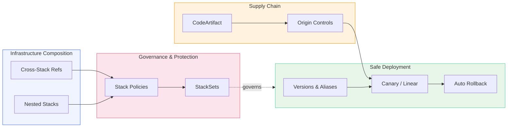

# Infrastructure as Code and Supply Chain Security on AWS: Patterns for Production

Over the last few months we published a set of hands-on posts on [AWS Builder Center](https://builder.aws.com/community/@hectorzelaya?tab=articles) covering two themes that sit at the heart of AWS DevOps: composing and governing infrastructure with CloudFormation, and securing what flows through your pipelines — both your dependencies and your Lambda deployments. Five posts, each with working templates, CLI commands you can run today, and the kind of production detail that only shows up once you move past the happy path.

Here's what we covered, where to find each post, and what it takes to run these patterns in a real environment.

## The Posts at a Glance

Each post stands on its own, but together they trace a path from single-stack templates to multi-account governance, and from dependency management to safe Lambda rollouts.

| # | Post | What You'll Build |
|---|------|-------------------|
| 1 | [Advanced CloudFormation: Cross-Stack References and Nested Stacks](https://builder.aws.com/content/3JyaKGAkWZU50pZRzyo4wa4yiHY/advanced-cloudformation-cross-stack-references-and-nested-stacks) | Layered infrastructure using `Export`/`Fn::ImportValue` for independent stacks and `AWS::CloudFormation::Stack` for same-lifecycle composition, plus a decision framework for choosing between them |
| 2 | [Protecting CloudFormation Resources with Stack Policies](https://builder.aws.com/content/3K0dgER05tWLBgXMcFDpyCk29WT/protecting-cloudformation-resources-with-stack-policies) | Stack policies that block accidental replacement of critical resources, temporary overrides for intentional changes, and how they layer with `DeletionPolicy`, `UpdateReplacePolicy`, and IAM |
| 3 | [CloudFormation StackSets: Multi-Account, Multi-Region Deployment](https://builder.aws.com/content/3KQUd1dvAAi16QVgV8LK88mdkxO/cloudformation-stacksets-multi-account-multi-region-deployment) | A security baseline deployed across Regions and accounts, self-managed vs. service-managed permissions, concurrency and failure-tolerance controls, and auto-deployment to new Organization accounts |
| 4 | [Managing Your Software Supply Chain with AWS CodeArtifact](https://builder.aws.com/content/3Ke7lRwcYM4DkcDPp6xxmb4xqPB/managing-your-software-supply-chain-with-aws-codeartifact) | A full CodeArtifact workflow — domains, upstream repos, external connections, origin controls against dependency confusion, CodeBuild integration, and cross-account sharing |
| 5 | [Deploying Lambda Functions Safely: SAM, CodeDeploy, Canary Strategies, and Automatic Rollback](https://builder.aws.com/content/3Ih9rOFVGvqe35aUj0wTQtDll9R/deploying-lambda-functions-safely-sam-codedeploy-canary-strategies-and-automatic-rollback) | Versions, aliases, and routing weights; raw CodeDeploy canary with pre-traffic hooks; SAM `DeploymentPreference`; and automatic rollback via hooks and CloudWatch alarms |

Every post includes runnable CLI commands and complete templates. You can deploy each lab, experiment, and tear it down cleanly when you're done.

Here's how the pieces relate — infrastructure composition and governance on one side, supply-chain and deployment safety on the other:

Posts 1–3 cover how you structure, protect, and distribute infrastructure. Posts 4–5 cover what moves through your pipelines: the packages your builds consume and the Lambda versions you ship. Taken together, they're the IaC and supply-chain backbone of an AWS DevOps practice.

Of course, running these patterns in a real environment brings additional concerns. Here are the areas we focus on when taking them to production.

## Production Considerations

### Composition and Change Safety

- **Pick the right composition pattern** — Cross-stack references for independent stacks owned by different teams; nested stacks for same-lifecycle modules the same team deploys as a unit. Choosing wrong creates coupling where you want freedom, or fragmentation where you want coordination.
- **Protect the resources you can't lose** — Attach stack policies that deny `Update:Replace` on VPCs, databases, and KMS keys. Remember that attaching any policy flips the default to deny-all, so you need explicit Allow statements for everything else.
- **Layer your guardrails** — Stack policies guard the update path, `DeletionPolicy` and `UpdateReplacePolicy` guard data on removal and replacement, termination protection guards the whole stack, and IAM controls who can do any of it. No single one is enough.
- **Review before you apply** — Use change sets with manual approval for anything touching networking or IAM, not just application code.

### Multi-Account Governance

- **Deploy baselines with StackSets** — Security controls, Config rules, CloudTrail, and public-access blocks belong in every account from day one. Service-managed StackSets with auto-deployment put them in new accounts the moment they join a target OU.
- **Control the blast radius** — Start conservative with concurrency and failure tolerance (`SEQUENTIAL` Region processing, low `MaxConcurrentCount`, a strict `FailureToleranceCount`) and widen as you gain confidence in a template.
- **Use a delegated administrator** — Keep the Organizations management account locked down; delegate StackSet operations to a dedicated tooling or security account.
- **Scope the execution role** — The lab uses `AdministratorAccess` for simplicity. In production, scope the StackSet execution role to only the resource types your templates create, and restrict the administration role to specific account ARNs.

### Supply Chain Security

- **Proxy everything through CodeArtifact** — Cached packages survive public-registry outages, and every pull is logged in CloudTrail. Point CI at CodeArtifact rather than hitting npmjs.com or PyPI directly.
- **Block dependency confusion by default** — First-time publishes set Publish=ALLOW, Upstream=BLOCK automatically. Reinforce it with package groups so every package under your internal namespace inherits the protection.
- **Grant least privilege for auth** — CodeBuild roles need `GetAuthorizationToken`, `GetRepositoryEndpoint`, `ReadFromRepository`, and `sts:GetServiceBearerToken` — nothing more. Share across accounts with a domain resource policy from a central tooling account.
- **Plan for VPC endpoints** — Builds running in private subnets need `codeartifact.api` and `codeartifact.repositories` endpoints, or `login` fails silently and npm falls back to the public registry.

### Deployment Safety

- **Shift traffic gradually** — Instantaneous, all-or-nothing Lambda deploys mean one bad version affects 100% of traffic. Canary and linear strategies limit exposure while you validate.
- **Validate before traffic shifts** — Pre-traffic hooks are the primary gate: they invoke the new version and reject a broken deploy before a single request reaches it.
- **Keep alarms as the backstop** — CloudWatch alarms catch what synthetic validation can't: latency regressions, throttling, and errors that only appear under real load. Wire them into the deployment group for automatic rollback.
- **Let SAM own the plumbing** — `AutoPublishAlias` and `DeploymentPreference` collapse the raw CodeDeploy mechanics into `sam deploy`. Understand the raw path once, then let the tooling run it.

## How AgilityFeat Can Help

These posts teach the building blocks. Assembling them into a governed, multi-account platform — one where infrastructure is composable, change is safe, dependencies are trusted, and deployments roll back on their own — is where the real engineering effort lives.

At [AgilityFeat](https://agilityfeat.com), our nearshore engineering teams specialize in exactly this:

- **Infrastructure as Code at scale** — From single-stack templates to layered cross-stack and nested architectures, with StackSets for organization-wide baselines and drift detection built into the pipeline. We design the composition and governance model so your teams ship infrastructure without stepping on each other.

- **Supply chain and deployment hardening** — CodeArtifact as a single control point for availability, origin controls, and audit; least-privilege IAM for CI; and safe Lambda rollouts with pre-traffic validation and automatic rollback. Whether you're starting fresh or stabilizing something that works in dev but isn't production-ready, we get it there.

- **Multi-account platform engineering** — Delegated administration, service-managed StackSets, OU-level targeting, and cross-account sharing wired into a proper landing zone.

Our teams work in your timezone (Latin America nearshore), integrate with your existing workflows, and bring AWS expertise from day one.

## What's Next

This set focused on the infrastructure-as-code and supply-chain side of AWS DevOps. We're continuing to publish on Builder Center, covering:

- CloudFormation governance and operations — drift detection, resource imports, and keeping stacks healthy
- Custom resources with Lambda for the gaps CloudFormation doesn't cover natively
- AWS CDK for teams outgrowing raw templates

Follow along on [AWS Builder Center](https://builder.aws.com/community/@hectorzelaya?tab=articles) for upcoming posts.

If you're ready to take these patterns from lab to production, [reach out to AgilityFeat](https://agilityfeat.com/contact-us/) — we're happy to talk through your infrastructure and deployment workflow and figure out where to start.
